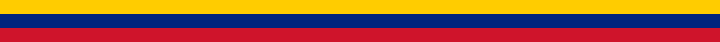

<p align="center">
  
</p>

<h1 align="center">VenGeoJSON</h1>

<p align="center">
  Capas geográficas de <strong>Venezuela</strong> en formato <a href="https://geojson.org/">GeoJSON</a> (RFC 7946),<br/>
  listas para mapas web, análisis espacial y aplicaciones que consuman datos vectoriales.
</p>

<p align="center">
  Sin dependencias ni compilación: archivos <code>.geojson</code> para servir de forma estática o importar en tu proyecto.
</p>

<p align="center">
  <strong>VenGeoJSON</strong> no es el SIG Geocadena ni forma parte del MPV/CENDITEL: es un repositorio <em>independiente</em> que republica y organiza capas GeoJSON tomadas de su fuente pública para facilitar el acceso (p. ej. Git, CDN, mapas web). Más detalle en <a href="#fuente-y-atribucion">Fuente y atribución</a> y en <a href="#mantenimiento">Mantenimiento</a>.
</p>

## Índice

- [Ejemplo en vista](#ejemplo-en-vista)
  - [Estados](#ejemplo-estados)
  - [Municipios](#ejemplo-municipios)
  - [Parroquias](#ejemplo-parroquias)
- [Contenido](#contenido)
  - [Tamaño aproximado](#tamano-aproximado)
- [Sistema de coordenadas](#sistema-de-coordenadas)
- [Scripts (`pnpm`)](#scripts-pnpm)
- [Esquema de datos](#esquema-de-datos)
  - [Estados](#estados)
  - [Códigos en `Estados/`](#codigos-estados)
  - [Estado `24` (La Guaira / Vargas)](#estado-24)
  - [Municipios](#municipios)
  - [Parroquias](#parroquias)
  - [Parroquias por municipio](#parroquias-por-municipio)
  - [Ciudades](#ciudades)
  - [Carreteras](#carreteras)
- [Uso rápido](#uso-rapido)
  - [Cargar en el navegador (fetch)](#cargar-en-el-navegador-fetch)
  - [Leaflet](#leaflet)
  - [Mapbox GL JS / MapLibre GL](#mapbox-gl-js-maplibre-gl)
  - [QGIS / GDAL](#qgis-gdal)
  - [Filtrar un solo estado](#filtrar-un-solo-estado)
- [Fuente y atribución](#fuente-y-atribucion)
  - [Qué es (y qué no es) este repositorio](#que-es-este-repo)
  - [Origen de las capas](#origen-capas)
  - [Licencia de los datos](#licencia-datos)
- [Notas](#notas)
- [Estructura del proyecto](#estructura-del-proyecto)
- [Contribuciones](#contribuciones)
- [Mantenimiento](#mantenimiento)

## Ejemplo en vista {#ejemplo-en-vista}

### Estados {#ejemplo-estados}

Vista previa de la capa [`venezuela.geojson`](venezuela.geojson) (entidades federales y zona en reclamación):

<p align="center">
  
</p>

<p align="center"><sub>Polígonos generados a partir de <code>venezuela.geojson</code> · WGS 84 · regenerar con <code>pnpm maps:svg</code></sub></p>

### Municipios {#ejemplo-municipios}

Vista previa de las capas [`Municipios/01.geojson`](Municipios/01.geojson) … [`24.geojson`](Municipios/24.geojson) (**335** municipios; no incluye la zona en reclamación):

<p align="center">
  
</p>

<p align="center"><sub>Polígonos generados a partir de <code>Municipios/*.geojson</code> · WGS 84 · regenerar con <code>pnpm maps:svg</code></sub></p>

### Parroquias {#ejemplo-parroquias}

Vista previa de las capas en [`Parroquias/`](Parroquias/) (**1 134** parroquias en carpetas por municipio; no incluye la zona en reclamación ni `ParroquiasAntiguas/`):

<p align="center">
  
</p>

<p align="center"><sub>Polígonos generados a partir de <code>Parroquias/*/*.geojson</code> (carpetas por municipio en la raíz de <code>Parroquias/</code>) · WGS 84 · regenerar con <code>pnpm maps:svg</code></sub></p>

## Contenido

| Archivo / carpeta | Descripción | Entidades |
|-------------------|-------------|-----------|
| [`venezuela.geojson`](venezuela.geojson) | División político-territorial nacional (estados, Distrito Capital y zona en reclamación). Estado `24` como **La Guaira** | 25 |
| [`MapasNacionalesAntiguos/venezuela.geojson`](MapasNacionalesAntiguos/venezuela.geojson) | Misma capa nacional con el estado `24` como **Vargas** | 25 |
| [`Estados/`](Estados/) | Un archivo por entidad federal (`01.geojson` … `24.geojson`) | 24 |
| [`Municipios/`](Municipios/) | Municipios de cada entidad federal (`01.geojson` … `24.geojson`) | 335 |
| [`Parroquias/`](Parroquias/) | Carpetas `2303_Cabimas/` … con un `.geojson` por parroquia (`230301.geojson`, …) | 1 134 |
| [`Parroquias/ParroquiasPorMunicipio/`](Parroquias/ParroquiasPorMunicipio/) | Un `FeatureCollection` por municipio (`2303.geojson`, …), generado a partir de las carpetas anteriores | 335 |
| [`ciudades.geojson`](ciudades.geojson) | Polígonos de localidades / áreas urbanas | 434 |
| [`carreterasDeVenezuela.geojson`](carreterasDeVenezuela.geojson) | Red vial (segmentos `LineString`) | 17 975 |

### Tamaño aproximado {#tamano-aproximado}

| Archivo | Tamaño |
|---------|--------|
| `venezuela.geojson` | ~6,3 MB |
| `MapasNacionalesAntiguos/venezuela.geojson` | ~6,3 MB |
| `Municipios/` | ~13,8 MB |
| `Parroquias/` | ~35 MB (incluye `ParroquiasPorMunicipio/` y `ParroquiasAntiguas/`) |
| `ciudades.geojson` | ~1,1 MB |
| `carreterasDeVenezuela.geojson` | ~12,9 MB |

Si publicas el repositorio en Git, conviene usar [Git LFS](https://git-lfs.com/) para los archivos grandes.

## Sistema de coordenadas

Todas las geometrías usan **WGS 84**: coordenadas en grados decimales **`[longitud, latitud]`** (orden GeoJSON estándar).

## Scripts (`pnpm`) {#scripts-pnpm}

Los scripts de mantenimiento están en `package.json`. Usa **pnpm** (no hace falta instalar dependencias: solo invocan Node):

| Comando | Descripción |
|---------|-------------|
| `pnpm fetch:municipios` | Descarga municipios OCHA → `Municipios/` |
| `pnpm fetch:parroquias` | Descarga parroquias OCHA → `Parroquias/` (+ `build:parroquias`) |
| `pnpm fetch:admin` | `fetch:municipios` y luego `fetch:parroquias` |
| `pnpm build:parroquias` | Agrupa parroquias sueltas en `Parroquias/ParroquiasPorMunicipio/` |
| `pnpm sync:estado-24` | La Guaira / Vargas en capas del estado `24` |
| `pnpm maps:svg` | Regenera `assets/mapa-venezuela-*.svg` |

## Esquema de datos

### Estados (`venezuela.geojson` y `Estados/NN.geojson`) {#estados}

Cada feature representa una entidad federal.

| Propiedad | Descripción |
|-----------|-------------|
| `COD_ESTADO` | Código de dos dígitos (`01`–`24`, más `00` en el archivo nacional) |
| `ESTADO` | Nombre en mayúsculas (como en Geocadena / OCHA) |

Geometrías: `Polygon` o `MultiPolygon` (por ejemplo Carabobo, Nueva Esparta, Zulia).

En `venezuela.geojson` aparece además la feature **`ZONA EN RECLAMACION`** (`COD_ESTADO`: `00`), correspondiente al área en disputa con Guyana (Esequibo). Esa entidad **no** tiene archivo propio en `Estados/`, `Municipios/` ni `Parroquias/`.

#### Códigos en `Estados/` {#codigos-estados}

| Archivo | `COD_ESTADO` | Estado |
|---------|--------------|--------|
| `01.geojson` | 01 | Distrito Capital |
| `02.geojson` | 02 | Amazonas |
| `03.geojson` | 03 | Anzoátegui |
| `04.geojson` | 04 | Apure |
| `05.geojson` | 05 | Aragua |
| `06.geojson` | 06 | Barinas |
| `07.geojson` | 07 | Bolívar |
| `08.geojson` | 08 | Carabobo |
| `09.geojson` | 09 | Cojedes |
| `10.geojson` | 10 | Delta Amacuro |
| `11.geojson` | 11 | Falcón |
| `12.geojson` | 12 | Guárico |
| `13.geojson` | 13 | Lara |
| `14.geojson` | 14 | Mérida |
| `15.geojson` | 15 | Miranda |
| `16.geojson` | 16 | Monagas |
| `17.geojson` | 17 | Nueva Esparta |
| `18.geojson` | 18 | Portuguesa |
| `19.geojson` | 19 | Sucre |
| `20.geojson` | 20 | Táchira |
| `21.geojson` | 21 | Trujillo |
| `22.geojson` | 22 | Yaracuy |
| `23.geojson` | 23 | Zulia |
| `24.geojson` | 24 | La Guaira |

#### Estado `24`: nombre anterior y actual {#estado-24}

El código **`24`** no cambia. Las capas actuales usan **La Guaira**; las carpetas **`*Antiguos`** conservan **Vargas**:

| Ubicación | `ESTADO` | Notas |
|-----------|----------|--------|
| `venezuela.geojson`, `Estados/24.geojson` | **LA GUAIRA** | Uso por defecto |
| `MapasNacionalesAntiguos/venezuela.geojson`, `Estados/EstadosAntiguos/24.geojson` | **VARGAS** | Misma geometría |

Regenerar con `pnpm sync:estado-24`. Las rutas están centralizadas en `scripts/legacy-dir.mjs`.

### Municipios (`Municipios/NN.geojson`) {#municipios}

Cada archivo reúne los municipios de una entidad federal. El nombre del archivo es el `COD_ESTADO` (`01`–`24`), el mismo que en `Estados/`.

| Propiedad | Descripción |
|-----------|-------------|
| `COD_ESTADO` | Código de dos dígitos, igual que en `Estados/` |
| `ESTADO` | Nombre del estado, igual que en `Estados/` |
| `COD_MUNICIPIO` | Código de cuatro dígitos (`0101`, `0201`, …). Los dos primeros dígitos coinciden con `COD_ESTADO` |
| `MUNICIPIO` | Nombre en mayúsculas |

Son **335** municipios. Para el estado **`24`**:

| Ubicación | `ESTADO` | `MUNICIPIO` (`2401`) |
|-----------|----------|----------------------|
| `Municipios/24.geojson` | **LA GUAIRA** | **VARGAS** (nombre del municipio en OCHA) |
| `Municipios/MunicipiosAntiguos/24.geojson` | **VARGAS** | **VARGAS** |

`fetch-municipios.mjs` escribe `Municipios/` y `Municipios/MunicipiosAntiguos/24.geojson` (`pnpm fetch:municipios`).

### Parroquias (`Parroquias/`) {#parroquias}

Cada **municipio** tiene su carpeta **directamente bajo `Parroquias/`**, con nombre **`{COD_MUNICIPIO}_{Municipio}`** en capitalización usual solo en el **nombre de carpeta** (p. ej. [`Parroquias/2303_Cabimas/`](Parroquias/2303_Cabimas/); dentro de los `.geojson`, `MUNICIPIO` y `PARROQUIA` siguen en mayúsculas). Cada parroquia es un archivo **`{COD_PARROQUIA}.geojson`** (`230301.geojson`, …).

Cada archivo es un `FeatureCollection` con **un solo** feature (la parroquia).

| Propiedad | Descripción |
|-----------|-------------|
| `COD_ESTADO` | Código de dos dígitos, igual que en `Estados/` |
| `ESTADO` | Nombre del estado, igual que en `Estados/` |
| `COD_MUNICIPIO` | Código de cuatro dígitos, igual que en `Municipios/` |
| `MUNICIPIO` | Nombre del municipio (tomado de `Municipios/` en este repo) |
| `COD_PARROQUIA` | Código de seis dígitos (`010101`, …). Coincide con el nombre del archivo sin extensión |
| `PARROQUIA` | Nombre en mayúsculas |

Son **1 134** parroquias en **335** carpetas de municipio (estados `01`–`24`; el COD-AB incluye una parroquia en `VE25` que aquí no se publica). Para el estado **`24`** (municipio `2401`):

| Ubicación | `ESTADO` | `MUNICIPIO` |
|-----------|----------|-------------|
| `Parroquias/2401_Vargas/*.geojson` | **LA GUAIRA** | **VARGAS** |
| `Parroquias/ParroquiasAntiguas/2401_Vargas/*.geojson` | **VARGAS** | **VARGAS** |

`fetch-parroquias.mjs` descarga `ven_admin3.geojson` del [COD-AB en HDX](https://data.humdata.org/dataset/cod-ab-ven) y regenera toda la carpeta `Parroquias/`. Requiere `Municipios/` (`pnpm fetch:municipios` antes, o `pnpm fetch:admin` para ambos).

### Parroquias por municipio (`Parroquias/ParroquiasPorMunicipio/`) {#parroquias-por-municipio}

Cada archivo `Parroquias/ParroquiasPorMunicipio/{COD_MUNICIPIO}.geojson` (p. ej. [`2303.geojson`](Parroquias/ParroquiasPorMunicipio/2303.geojson) para Cabimas) es un `FeatureCollection` con todas las parroquias de ese municipio, ordenadas por `COD_PARROQUIA`. Se genera a partir de las carpetas sueltas en `Parroquias/`; no incluye `ParroquiasAntiguas/`.

Regenerar con `pnpm build:parroquias` (también se ejecuta al final de `pnpm fetch:parroquias`).

```bash
pnpm build:parroquias
```

### Ciudades (`ciudades.geojson`) {#ciudades}

Polígonos de localidades.

| Propiedad | Descripción |
|-----------|-------------|
| `gid` | Identificador del registro |
| `nombre` | Nombre de la localidad |
| `codigo` | Código asociado (p. ej. división administrativa) |
| `superficie` | Superficie (unidad según fuente original) |
| `perimetro` | Perímetro (unidad según fuente original) |

### Carreteras (`carreterasDeVenezuela.geojson`) {#carreteras}

Segmentos de vía como `LineString`.

| Propiedad | Descripción |
|-----------|-------------|
| `NOMBRE` | Nombre de la vía (puede estar vacío) |
| `CARRETERA` | Clasificación (p. ej. `ENGRANZONADA`, `TERCER ORDEN`, `SEGUNDO ORDEN`) |
| `TIPO` | Tipo de vía (p. ej. `E`, `D`, `C`, `U`) |
| `PAVIMENTO` | Pavimentación (`SI`, `NO` o vacío) |
| `OBSERVACIO` | Observaciones |

## Uso rápido

### Cargar en el navegador (fetch)

```javascript
const response = await fetch("/venezuela.geojson");
const geojson = await response.json();
```

Sirve los archivos desde tu servidor web o CDN con el tipo MIME `application/geo+json` (o `application/json`).

### Leaflet

```javascript
import L from "leaflet";

const map = L.map("map").setView([8.0, -66.0], 6);

L.tileLayer("https://{s}.tile.openstreetmap.org/{z}/{x}/{y}.png", {
  attribution: "&copy; OpenStreetMap",
}).addTo(map);

const states = await fetch("venezuela.geojson").then((r) => r.json());

L.geoJSON(states, {
  style: { color: "#3388ff", weight: 1, fillOpacity: 0.2 },
  onEachFeature: (feature, layer) => {
    layer.bindPopup(feature.properties.ESTADO);
  },
}).addTo(map);
```

### Mapbox GL JS / MapLibre GL

Añade una fuente `geojson` y una capa `fill` o `line` apuntando a la URL del archivo (o incrusta el GeoJSON en el estilo si el tamaño lo permite).

### QGIS / GDAL

- **QGIS**: *Capa → Añadir capa → Añadir capa vectorial* y selecciona el `.geojson`.
- **ogr2ogr** (convertir a otro formato):

```bash
ogr2ogr -f GeoPackage venezuela.gpkg venezuela.geojson
```

### Filtrar un solo estado

Usa el archivo correspondiente en `Estados/` (por ejemplo `Estados/13.geojson` para Lara) en lugar de filtrar el GeoJSON nacional. Los municipios de ese estado están en `Municipios/13.geojson`. Las parroquias sueltas están en **`Parroquias/`** (p. ej. `Parroquias/1301_…/`). El resumen por municipio está en **`Parroquias/ParroquiasPorMunicipio/1301.geojson`**, etc.

### Parroquias de un municipio (ej. Cabimas)

Cabimas (`COD_MUNICIPIO` **2303**):

- **Una parroquia:** [`Parroquias/2303_Cabimas/230301.geojson`](Parroquias/2303_Cabimas/230301.geojson)
- **Todo el municipio:** [`Parroquias/ParroquiasPorMunicipio/2303.geojson`](Parroquias/ParroquiasPorMunicipio/2303.geojson)

```javascript
const ambrosio = await fetch("Parroquias/2303_Cabimas/230301.geojson").then((r) =>
  r.json()
);

const cabimas = await fetch("Parroquias/ParroquiasPorMunicipio/2303.geojson").then(
  (r) => r.json()
);
```

En **QGIS**: `Parroquias/ParroquiasPorMunicipio/2303.geojson` o capas sueltas en `Parroquias/2303_Cabimas/*.geojson`.

## Fuente y atribución {#fuente-y-atribucion}

### Qué es (y qué no es) este repositorio {#que-es-este-repo}

| | Descripción |
|---|---|
| **VenGeoJSON** (este repo) | Copia u organización de capas **GeoJSON** publicadas por el MPV/Geocadena, más municipios y parroquias del COD-AB de OCHA, con enlaces a la fuente original, para facilitar en **Git/GitHub** (u otro hosting) la descarga y el uso en mapas y apps. **No incluye** el código ni los servicios del SIG Geocadena. `Estados/`, `Municipios/` y `Parroquias/` dividen las capas por entidad (`01`–`24`). `MapasNacionalesAntiguos/`, `Estados/EstadosAntiguos/`, `Municipios/MunicipiosAntiguos/` y `Parroquias/ParroquiasAntiguas/` guardan la denominación **Vargas** para el estado `24`. |

En **VenGeoJSON**, los **datos** de los `.geojson` (geometrías y atributos) vienen de la fuente indicada abajo. Lo **propio de este repo** (README, carpeta `Estados/`, `scripts/`, `assets/`, etc.) es empaquetado y documentación de [**Ejeoxlac**](https://github.com/Ejeoxlac), mantenedor del repositorio, no del MPV.

### Origen de las capas {#origen-capas}

Las capas provienen del **Sistema de Información Geográfico (Geocadena)** del MPV, disponibles en el [índice de capas GeoJSON de Geocadena](https://mpv.cenditel.gob.ve/cadenas/browser/observatorio/procesos/apps/geocadena/media/geojson?rev=3f752f81c0f97fe4083947a5d432021bdf587bba&order=name). Para contexto del software institucional (no sustituye la fuente de datos): [wiki del módulo Cadenas](https://mpv.cenditel.gob.ve/cadenas/wiki).

| Capa en este repo | En Geocadena (MPV) |
|-------------------|-------------------|
| `venezuela.geojson`, `Estados/*.geojson` | División político-territorial estadal — p. ej. [`venezuela.geojson`](https://mpv.cenditel.gob.ve/cadenas/browser/observatorio/procesos/apps/geocadena/media/geojson/venezuela.geojson). En este repo, el `24` del archivo nacional usa **La Guaira**; Geocadena publica **Vargas** (copia en `MapasNacionalesAntiguos/venezuela.geojson`). |
| `ciudades.geojson`, `carreterasDeVenezuela.geojson` | Misma [carpeta de medios GeoJSON](https://mpv.cenditel.gob.ve/cadenas/browser/observatorio/procesos/apps/geocadena/media/geojson?rev=3f752f81c0f97fe4083947a5d432021bdf587bba&order=name); confirma el nombre del archivo en el índice (puede diferir del de este repo). |
| `Municipios/*.geojson` | **No** proviene de Geocadena. Límites municipales (admin 2) del COD-AB de Venezuela, [OCHA / HDX](https://data.humdata.org/dataset/cod-ab-ven), servicio `ven_admbnda_adm2_ine_20210223` (INE, válido desde febrero de 2021; revisión HDX de enero de 2025). Licencia [CC BY-IGO](https://creativecommons.org/licenses/by/3.0/igo/legalcode). Regenerar con `pnpm fetch:municipios`. |
| `Parroquias/**/*.geojson` | **No** proviene de Geocadena. Límites de parroquias (admin 3) del mismo COD-AB, archivo `ven_admin3.geojson` en [ven_admin_boundaries.geojson.zip](https://data.humdata.org/dataset/cod-ab-ven) (INE, febrero de 2021). Misma licencia [CC BY-IGO](https://creativecommons.org/licenses/by/3.0/igo/legalcode). Regenerar con `pnpm fetch:parroquias`. |

**Atribución de los datos** (no de VenGeoJSON como proyecto CENDITEL): estados, ciudades y carreteras © Fundación CENDITEL — Observatorio Productivo Venezolano, módulo Geocadena. Municipios y parroquias © OCHA Venezuela / HDX, COD-AB (CC BY-IGO).

### Licencia de los datos {#licencia-datos}

Este repositorio es un **empaquetado de conveniencia** por terceros; no sustituye los términos del titular de los datos ni implica que CENDITEL avala esta copia. CENDITEL ha descrito el SIG del observatorio como desarrollo en **software libre**; eso no implica por sí solo que todas las capas GeoJSON puedan redistribuirse bajo una licencia tipo MIT. Antes de republicar los archivos o usarlos en productos comerciales, revisa las condiciones publicadas en MPV/CENDITEL o consulta al titular. Los metadatos de los `.geojson` de estados, ciudades y carreteras no incluyen licencia explícita.

Los archivos de `Municipios/` y `Parroquias/` (incluido `ParroquiasPorMunicipio/`) se publican bajo [CC BY-IGO](https://creativecommons.org/licenses/by/3.0/igo/legalcode): hay que atribuir a OCHA Venezuela / HDX. Esa licencia no cubre el resto de capas.

## Notas

- Los límites administrativos y la red vial pueden no coincidir con la cartografía oficial más reciente; verifica antes de usarlos en producción o en informes legales.
- Algunos nombres en `ciudades.geojson` pueden mostrar problemas de codificación de caracteres (UTF-8 mal interpretado en la fuente).
- Si redistribuyes las capas, mantén la atribución de la sección [Fuente y atribución](#fuente-y-atribucion) y los términos que correspondan al MPV/CENDITEL.

## Estructura del proyecto

```
VenGeoJSON/
├── README.md
├── assets/
│   ├── bandera-venezuela.svg
│   ├── mapa-venezuela-estados.svg
│   ├── mapa-venezuela-municipios.svg
│   └── mapa-venezuela-parroquias.svg
├── package.json
├── scripts/
│   ├── build-parroquias-por-municipio.mjs
│   ├── fetch-municipios.mjs
│   ├── fetch-parroquias.mjs
│   ├── generate-map-svg.mjs
│   ├── legacy-dir.mjs
│   └── sync-estado-24.mjs
├── venezuela.geojson
├── MapasNacionalesAntiguos/
│   └── venezuela.geojson          ← estado 24 = Vargas
├── ciudades.geojson
├── carreterasDeVenezuela.geojson
├── Estados/
│   ├── 01.geojson … 24.geojson    ← 24 = La Guaira
│   └── EstadosAntiguos/
│       └── 24.geojson
├── Municipios/
│   ├── 01.geojson … 24.geojson
│   └── MunicipiosAntiguos/
│       └── 24.geojson
├── Parroquias/
│   ├── 2303_Cabimas/
│   │   ├── 230301.geojson
│   │   └── …                         ← una carpeta por municipio (335)
│   ├── ParroquiasPorMunicipio/
│   │   └── 0101.geojson … 2401.geojson  ← agrupado (335 archivos)
│   └── ParroquiasAntiguas/
│       └── 2401_Vargas/
│           └── 240101.geojson …
```

## Contribuciones

Las mejoras bienvenidas incluyen: simplificación de geometrías para web, corrección de topología, normalización de nombres, metadatos de fuente y licencia, y versiones ligeras (TopoJSON o archivos por estado para carreteras).

## Mantenimiento

**VenGeoJSON** es un proyecto personal de [**Ejeoxlac**](https://github.com/ejeoxlac) (Bill Anthony Niño Riera): empaqueta y documenta capas GeoJSON de la fuente MPV/Geocadena para facilitar su distribución. **No** representa a CENDITEL ni al Observatorio Productivo Venezolano.
